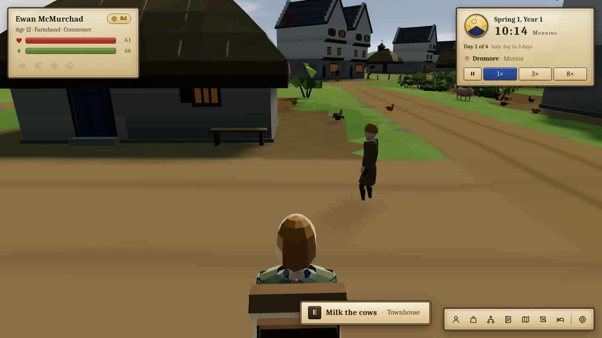
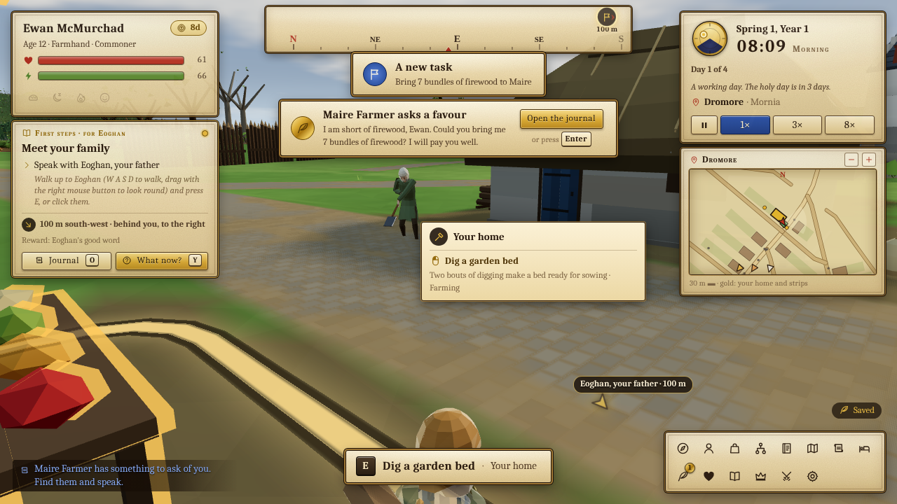
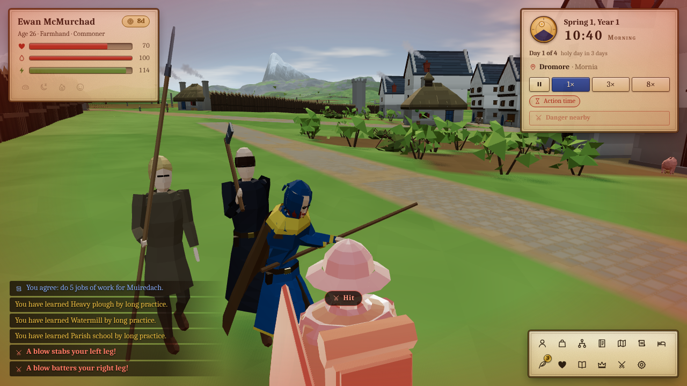
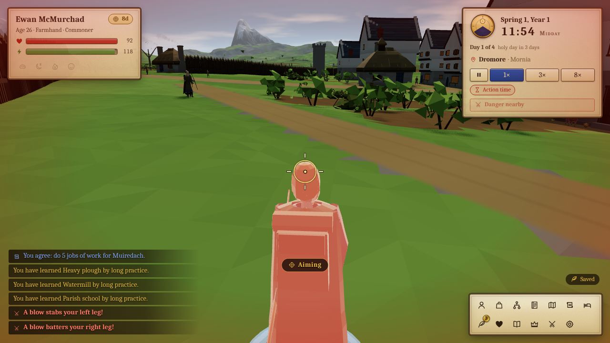
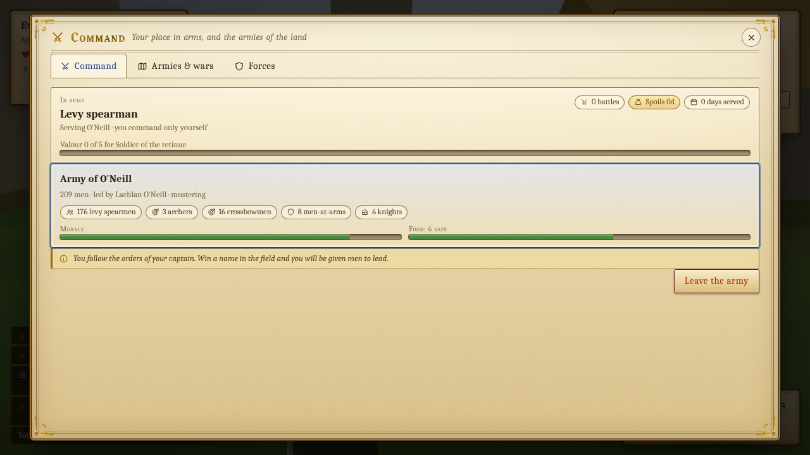
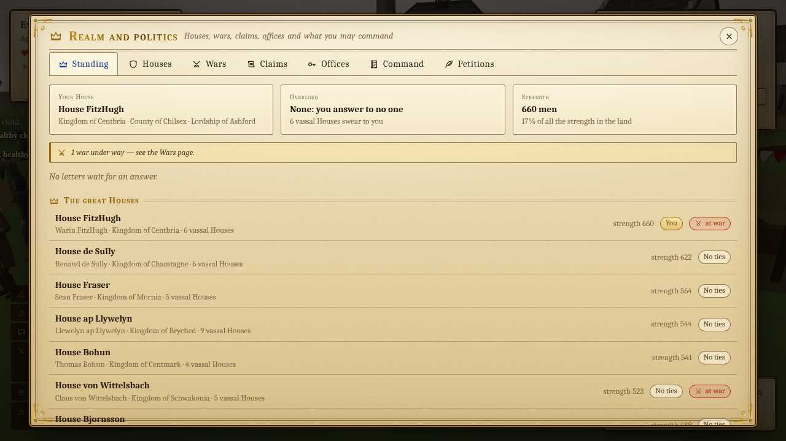
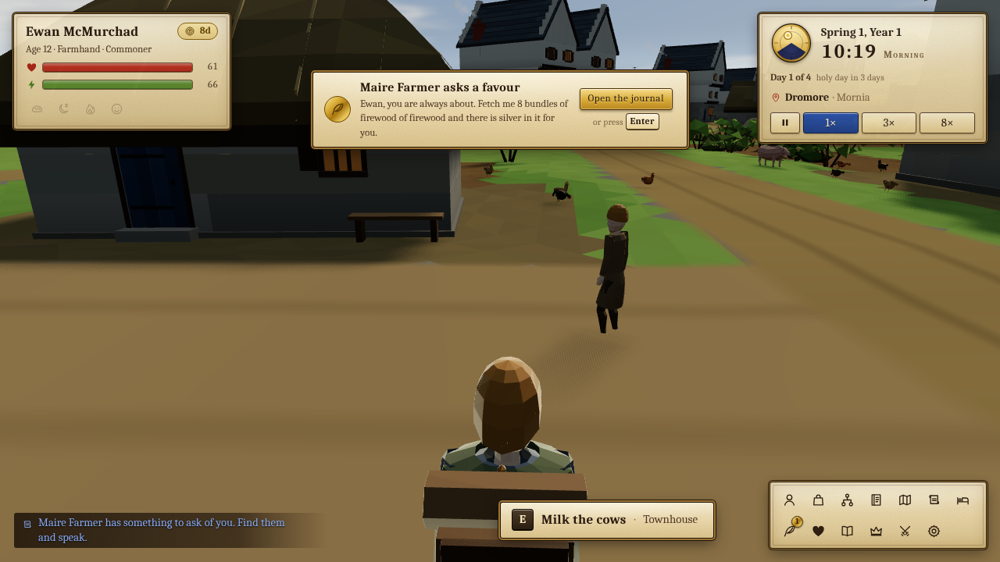
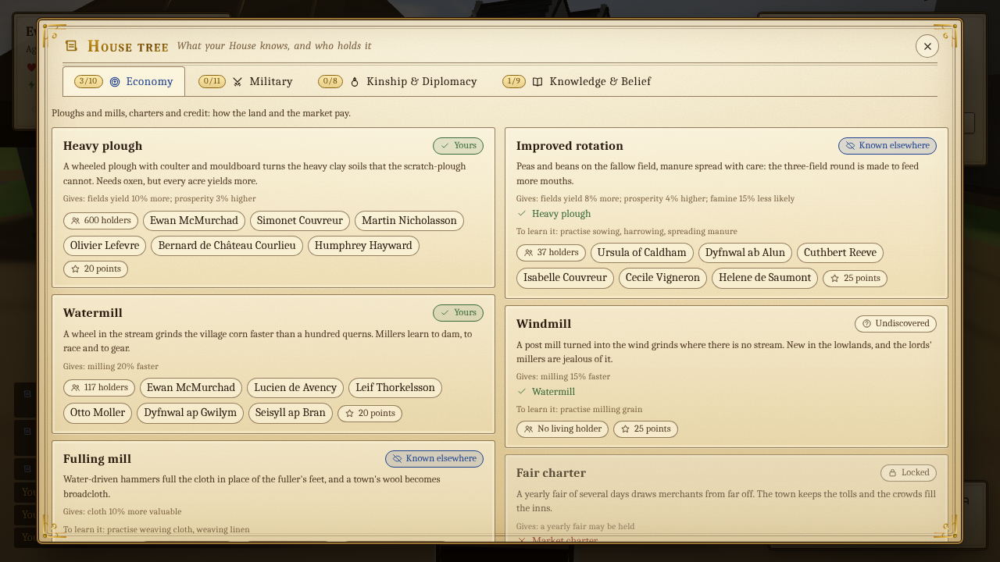

# Millennia

**Live one life at a time inside a fully simulated medieval world.** Millennia is a 3D, browser-based
life-and-dynasty simulation: you are born a peasant child in a village of a procedurally generated continent
and play the person you are, at street level, in real time. Work the strips, learn a trade, fall in love, take
up a bow, answer your lord's call to arms, stand for reeve, win a manor, a barony, a crown. When you die the
story does not stop: you take over a child, a spouse or a kinsman and the House carries on, along with ten
thousand other lives that go on whether you watch them or not.

Built with TypeScript (strict), Vite and Three.js, with no other runtime dependencies. Everything you see (terrain,
houses, people, animals, weather) is generated by code at load time; there are no image or model files.



## Run it

```bash
npm install
npm run dev            # open the printed URL, normally http://localhost:5173/
```

```bash
npm run build          # type-check and make a production build in dist/
npm run preview        # serve the build
```

The game is the default mode. The main menu offers **Continue** (one run is kept, saved to IndexedDB every few
seconds), **New run** (difficulty, then the lord you start as) and
the settings. A new continent takes about four seconds to raise in a browser. Chrome, Edge and Firefox with WebGL2
are fine; the *quality* setting (low / medium / high) trades shadows and view distance for speed.

## How it plays

You walk the village in third person with a **free cursor**. Point at a person, a door, a strip or a tree and a label
says what it is and what a click will do; **click** to walk there and do it (or stand close and press **E**; hold **E** for
every option). Hold the **right button** and drag to turn the camera. What you are meant to be doing is written in the
top left corner (the *tracker*), shown by a gold marker in the world, the compass ribbon and the minimap; **Y** asks
"what now?" and **O** opens the journal. A day lasts ten minutes, a season four days, a year sixteen: speed it up with
**2** and **3** while you wait, slow down when you work or fight. When you sleep, the day is written up.



| Key / mouse | Action |
|---|---|
| **W A S D**, **Shift**, **X**, **Space** | Move, sprint, slow walk, dodge roll |
| **Left click** | Walk to the thing under the cursor and do its default action (any movement key stops you) |
| **Right button** (hold, drag) | Turn the camera; the cursor comes back where it was |
| **E** (tap / hold) | The default action on what you face / the action wheel |
| **G** | Draw or put away your weapon; while it is drawn (or in a fight) the mouse looks: left strikes, right guards, bow: draw and aim |
| **F**, **Q** | Mount a horse, stop the work in hand |
| **1 2 3**, **P** | Speed 1×, 3×, 8×; pause |
| **Y**, **O**, **N** | What now? card, the journal (tasks, today, people, places), minimap on or off |
| **Tab I H J M L Z** | Character, inventory, family and House, ledger, map and travel, chronicle, sleep or wait |
| **R B T K C** | Requests and news, wounds, House techniques, realm and politics, command and army |
| **F1**, **Esc** | Help and controls; Esc leaves mouse-look, else closes a page, else the pause menu |

The same list, and how to play, is in the game (**F1** or the pause menu) and in [docs/PLAYING.md](docs/PLAYING.md). In
your first minutes a scene-setting card and a short tour of home, strip and church lead into a first day of tasks
(meet your family, fetch water, help on the strip, sleep at home), and a few small hint cards teach the controls; they
can be dismissed or switched off in the settings. The old scheme (the mouse always turns the camera) is the setting
*Always use mouse-look*.

### What is in it

- **A living continent.** Kingdoms, counties, towns, villages, castles and abbeys on generated terrain; more than ten
  thousand people with families, trades, moods and memories; markets with real prices; seasons, weather, harvests,
  famine and plague. Only people near you are drawn in detail; the rest live by the simulation's own rules.
- **A life.** Stats and skills that grow by practice, perks, careers (farmer, craftsman, merchant, priest, soldier, knight,
  outlaw, noble…), marriage and children, property, dues and rank, and a family tree that is your lives' continuity.
- **Combat and wounds.** Melee with weapons, shields and armour, bows, crossbows and lances; blows leave wounds that
  bleed and mend (or fester); nobles yield and are ransomed.
- **War and politics.** Lords raise levies; armies muster, march, besiege castles and raid villages; Houses form
  alliances, press claims, make peace; elections fill the posts of a town; peasants rebel.
- **Techniques and events.** What a House knows (ploughs, mills, schools, longbows, trebuchets) lives in its people and
  can be learned, taught and lost. Villagers ask favours; fires, fairs, plague and outlaws come and go.

| | |
|---|---|
|  |  |
| Melee: stance chip, blood bar, red flash on a blow | Bow: the reticle's ring closes as the string comes back |
|  |  |
| Command and army, with the levy call | Realm and politics |
|  |  |
| Notices open the right page (Enter) | The House tree |

## Developer modes

Choose the entry with `?mode=` on the URL (default `game`):

| `?mode=` | What it is |
|---|---|
| `game` | the game. Extras: `autostart=1`, `seed=abc`, `difficulty=squire\|knight\|lord\|king`, `quality=`, `time=0..1`, `season=0..3`, `debug=1` (frame and system timings), `shots=1` (hooks for tools), `hud=1`, `devzone=1` |
| `world` | fly over a generated continent (renderer) |
| `gallery` | every building, plant, crop, prop and effect |
| `chars` | characters, horses, animals and all their animations |
| `village` | a single settlement living its day (agents, routines, animals) |
| `ui` | every screen and panel of the UI with mock data |

## Tools

Headless Node tools run with `npx tsx tools/<name>.ts`; browser tools use Playwright with the preinstalled
Chromium (software GL, so they are slow) and write screenshots under `docs/`.

| Tool | Purpose |
|---|---|
| `tools/fullsim.ts --years 30` | the whole simulation (every module, real continent): population, food, wars, battles, sieges, raids, happenings, slowest systems |
| `tools/headless.ts` | macro life only: demographics over N years (`npm run sim`) |
| `tools/econ.ts --preset real` | economy report: prices, prosperity, hunger |
| `tools/pacing.ts` | how often something turns up for the player (SPEC §21) |
| `tools/politics.ts` | wars, changes of power and politics' cost per year |
| `tools/worldmap.ts` | renders a continent to PNG |
| `node tools/game-shots.mjs` | screenshots of the real game (village, street, prompt, map, travel, fights, panels…) into `docs/game/` |
| `node tools/game-clarity-shots.mjs` | screenshots of the clarity pass (tracker, compass, minimap, "What now?", banner, cursor tooltips, journal, day summary, intro and tour) into `docs/game/clarity-*.png`; `--size=1920x1080`, `--real` for the real objectives module |
| `node tools/game-flow.mjs` | clicks and types through a whole session (run start, hotkeys, pages, notices, a journey, death, save and continue) and checks what the game reports |
| `tools/render-shots.mjs`, `gallery-shots.mjs`, `chars-shots.mjs`, `village-shots.mjs`, `ui-shots.mjs`, `combat-shots.mjs`, `military-shots.mjs`, `politics-shots.mjs`, `advancement-shots.mjs` | per-module screenshot sets |

## Tests

```bash
npm run typecheck      # tsc --noEmit
npm test               # vitest: unit and integration suites for every module (tests/ mirrors src/)
npm run test:perf      # timing budgets (run alone, they are sensitive to machine load)
npm run test:long      # long demographic runs (SIM_LONG=1)
```

Determinism is a rule: the simulation draws every random number from named streams of the run's seed, so the same seed
and the same inputs give the same world, and a save round trip is hash-identical (tested).

## Architecture map

```
src/core/      shared contracts and utilities: math, rng, noise, time, events, domain types, the view model
src/content/   data tables (JSON): goods, recipes, buildings, careers, perks, techs, happenings, dialogue
src/world/     continent generation (terrain, rivers, kingdoms, roads, settlements); static per seed
src/sim/       the simulation, no DOM and no three: state, clock, population, life, careers, money, save
  economy/       farming, crafts, markets, prices, jobs, dues, holdings, needs
  social/        opinions, conversation, courtship, news, speech
  politics/      Houses, titles, diplomacy, wars, offices and elections, management, unrest
  military/      forces, levies, armies, battles, sieges, raids, ransom, the player's career in arms
  advancement/   techniques that live in people, learning, loss
  happenings/    events, disasters, requests, festivals
src/agents/    the detail zone near the player: navigation, routines, steering, animals
src/combat/    melee, archery, wounds, the player's fighting port, NPC fight AI
src/player/    possession of a character: movement, interaction, riding, map travel, encounters
src/assets/    procedural models and materials: buildings, characters, animals, vegetation, props
src/render/    the Three.js renderer: terrain streaming, water, sky, lighting, vegetation, cameras
src/ui/        the DOM UI: HUD, panels, menus, notices, the first-minutes guide
src/app/       bootstrap, main loop, input, saving, the run session
tools/         headless tools and screenshot scripts          tests/   vitest suites mirroring src/
docs/          design and module docs, screenshots
```

Where to read next:

- [docs/SPEC.md](docs/SPEC.md): what the game is (pillars, systems, controls).
- [docs/ARCHITECTURE.md](docs/ARCHITECTURE.md): how it is built (contracts, module plug-in rules, budgets).
- [docs/PLAYING.md](docs/PLAYING.md): playing, controls, the screen, fighting, war and politics.
- Module notes: [docs/ECONOMY.md](docs/ECONOMY.md), [docs/SOCIAL.md](docs/SOCIAL.md), [docs/AGENTS.md](docs/AGENTS.md),
  [docs/ART.md](docs/ART.md), `src/sim/politics/README.md`, and the folders under `docs/` (`combat`, `military`,
  `advancement`, `render`, `ui`…) for module screenshots.
