# Lands UI: builder mode, ruler mode, *Rule this town*, the map (civilization pass, wave B1)

The interface of `docs/CIV.md` §5 (builder mode), §6 (ruler mode), §2 and §4 (the map, living as the ruler of a town) and §10 (the news).
Everything here is a view over services that wave A built (`construction`, `realm`, `territory`, `economy`) and acts only through
their calls, as the AI rulers do; nothing in it changes the simulation by any other road.

| | key | where it is | what it is |
|---|---|---|---|
| **Builder mode** | `B` | `src/ui/builder/` (ext panel `'builder'`) | the camera lifts over your land; a catalogue, a ghost, sites, buildings, the works queue |
| **Ruler mode** | `U` | `src/ui/ruler/` (ext panel `'ruler'`) | the seat of government, eight pages |
| **Rule this town** | banner, map, ruler's lists, builder's card | `src/ui/ruler/ruleTown.ts` | one click opens the live-as panel on the person who rules the place |
| **The map** | `M` | `src/ui/panels/map.ts`, `src/ui/core/mapModel.ts` | borders by House, deposits, outposts, filters, *People here* |
| **The banner** | (on entering a place) | `src/ui/hud/banner.ts` | *Rule this town* under the name |
| **News toast** | (on a `news` event, threat ≥ 0.5) | `src/ui/ruler/newsToast.ts` | a ribbon with a link to the Rivals page |

To try them in the running game: `B`, `U`, `M`; *Rule this town* needs the live-as panel of wave B6 (until it is merged the ext
panel says "Not yet written"; from the console `__game.session.sim.switchTo(__game.session.sim.services.realm.rulerOf(settlementId))`
does the same by hand). `node tools/lands-flow.mjs` checks all of it in a browser; `node tools/lands-shots.mjs` makes the pictures below.

## 1. Builder mode (`B`)

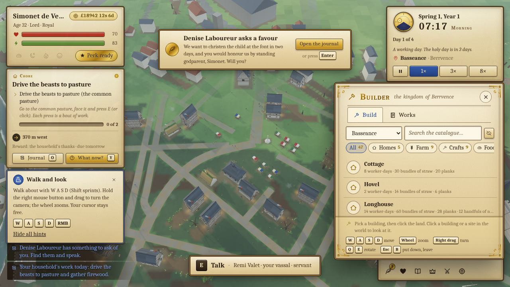

**Who may open it.** `construction.scope(me)`: if its `role` is `'none'` (a child, a prisoner, someone who heads no household and holds
no office or title) a card says why in the module's own words ("Too young to build", "Only the head of the household builds for it
(Godwin)", "You hold no land to build on"), lists what would let a person build (head of a household on his plot, a master in his
workshop, an office, a manor, a barony and the wild), and offers *Rule …* for the town nearby and *Live as the head of the
household*. No camera moves.

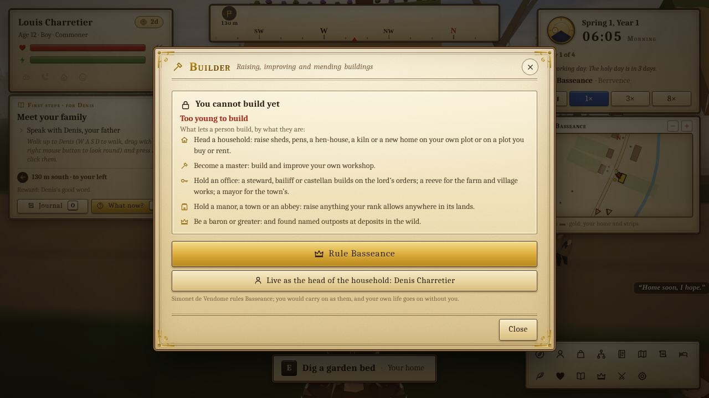

**The camera.** `controls.setOverview({ x, z, radius, distance })` over the settlement (a household head: over his home, closer),
and `orbit` / `zoom` / `pan` drive it: **WASD and the arrows** pan (`pan(-right·dt·600, forward·dt·600)`, as the map's keys do),
**the wheel** zooms, **right or middle drag** turns. `Esc` or `B` leaves and the camera goes back (`setOverview(null)`). The land you
may build on is tinted: `setBuildArea(construction.buildArea?.(me) ?? [])` once a second (the module hands back the same array until
something changes). The world keeps running (the panel is `pauses: 'never'`; the HUD keeps its clock and feed) but the input layer
is held (`captures: true`), so keys and the mouse belong to the builder.

*Which camera.* The renderer's overview camera exists in the contract, but a renderer without it (or the controls of an older host)
simply does nothing when asked. The builder therefore *looks* (`builderCamera.ts`, `cameraVerdict`): a bird's-eye camera shows scores
of metres of ground across the middle half of the screen (`screenToGround` at a quarter and three quarters of the width), the
player's own a dozen, so a view that is wide and stays wide for three frames is the renderer's overview camera. A picture that has
not moved for a dozen frames and half a second (the call went to nothing), or one that only moves as the follow camera does while
the player walks, once 60 frames and 1.3 s have gone (more than any glide), makes the builder lay a bird's-eye camera of its own
with `setCameraPose` (`cameraModel.ts`, same keys, same limits: the look-at stays in the circle, zoom 20 m to 2.2 × the radius). A
camera that merely moves is never taken for the overview camera.

**The catalogue** (`catalogue(me, where)`). Every kind of building (63), by category (homes, farm, crafts, food and drink, church,
civic, defence, resources, military), the ones you may raise first. Each row: name, cost in one line (worker-days, goods, cash), and for
the ones you may not, the **reason** in red under it (the module's: "Only the lord of Dromore may raise a wall", "Needs the technique
Curtain walls", "There is a church already: one is all the place can keep"). A search box, category chips with the count that are open,
a *where* selector when you may build in more than one place (your settlements; *The wild* for a baron), an eye button to hide what you
cannot raise. The **tool bar** along the bottom of the view shows the chosen kind: what it does, its cost as goods with their icons
(red where your stores fall short, with how much would be bought and carted), the requirements (technique, terrain, deposit, rank, how
many a place may hold) and, for homes, whether *our household moves in* or it is *let to a family*.

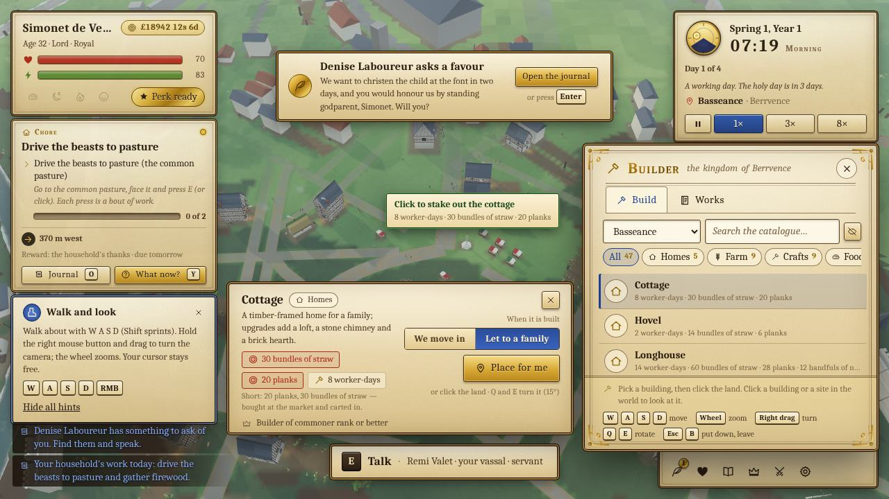

**The ghost.** With a kind chosen, every frame: `screenToGround(cursor)` → `construction.check(me, kind, x, z, rot)` (memoised in
the module) → `setGhost({ kind, level, x, z, rot, ok, footprint })` and, by the cursor, a label: green *"Click to stake out the
cottage"* with the cost, or the red reason ("Overlaps the smithy", "On the road", "Too steep", "Not your land", "Needs a river bank").
`Q` / `E` turn it 15°, **Shift + wheel** too. A click that fits calls `place(me, kind, x, z, rot, { occupant })`; the tool stays in
hand for the next. A right click that did not turn the camera, or `Esc`, puts it down.

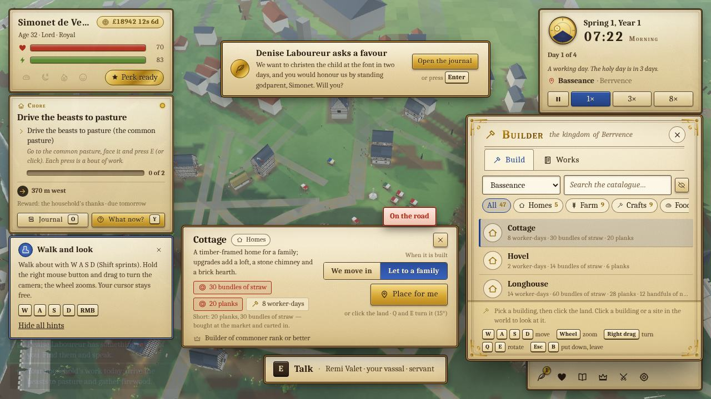

**Place for me.** `suggestSpot(me, kind, where, centreOfTheView)`; the camera glides there (a pan toward the middle of the screen,
frame by frame, through `project`, so it works with either camera), the ghost stands there, and a bar asks *Stake it out / Another spot /
Cancel* (`Another spot` looks from a point 45 m off the last, turning a little each time).

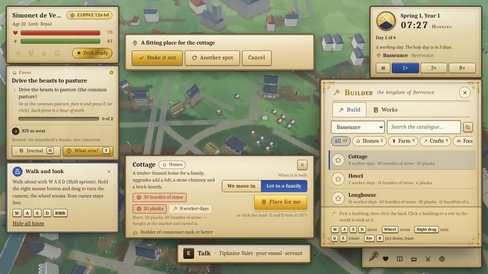

**Outposts.** Where `check` says a spot would found one (`check.outpost.id === 0`: the wild, a baron's right), a click opens a small
card to name it, offering a default from the deposit under it ("Iron camp", "Stone quarry", "Clay pit", "Salt pans", "Lumber camp") and
passes the name as `place(..., { outpost })`.

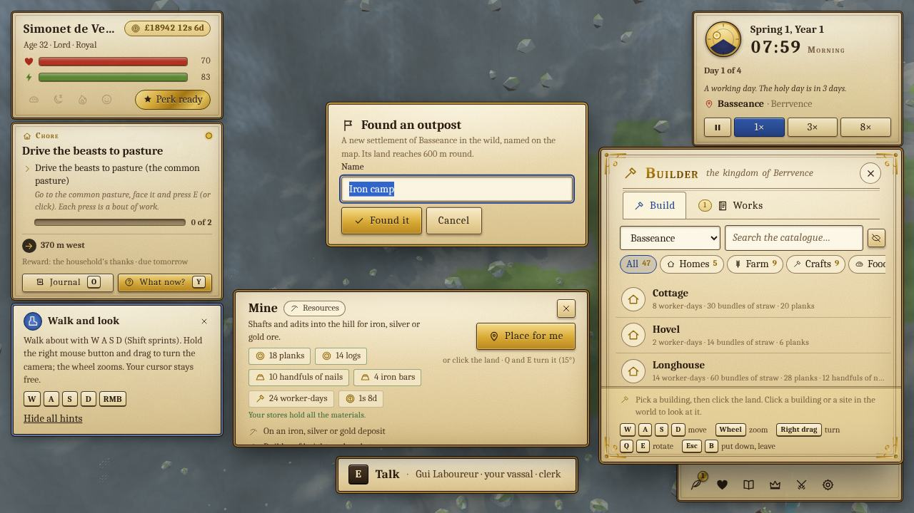

**Buildings and sites you click** (`pick(x, y)`). A standing building: its name, level, owner ("your household's", "House Avenel's"),
condition (a bar and a word from `damage`), and **Upgrade / Repair / Demolish**, each with the module's `quote` as its price
("Level 2: 3 worker-days · 8 planks") or its reason ("Nothing to mend"); demolishing asks first. A site: the work and its stage (pegs and
lines, footings, frame and walls, roof), the progress, the materials' share in, what is **still missing with what is on the way**
(`economy.deliveries(household)`: "12 planks — all on the way from Dromore, due in 2 days"), the labour left, who works today, the
estimated finish, the module's `note`; and, when `canManage`: **hired hands** (− / + / Auto → `setHired`), **Work this first / last**
(`setPriority`), **Cancel the work** (asks first: 70 % of the delivered materials come back).

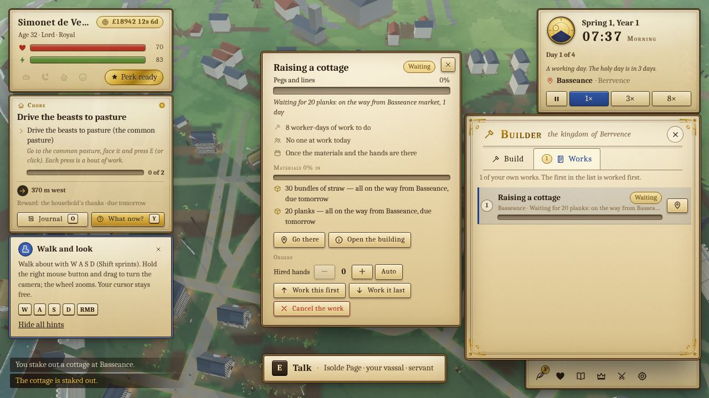
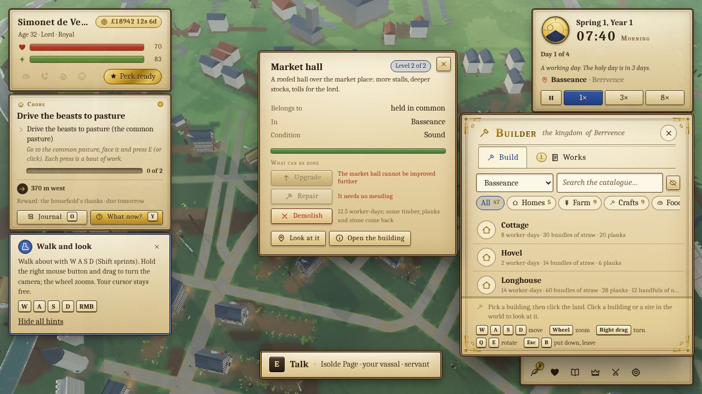

**The works queue** (*Works* tab): all your sites in the order they are worked (`priority`), with status, progress and what they wait
for, the works of others in the places you have a say in after them, dimmed; a click jumps the camera there and opens the site.

## 2. Ruler mode (`U`)

For `realm.canRule(me)`; otherwise a card says you rule nothing and offers the towns near you with someone to take over (*Rule …*).
A full page over the world (`pauses: 'menu'`, as the other full pages: the world waits unless the player unpauses), eight pages
(`←` `→` or `1`–`8` switch them; the page you left is the page it opens on), and a footer that is polled twice a second
(`realm.view(me)`: the treasury moves without a version bump). Every order shows its **reason** when the realm refuses (a red strip at
the top of the page and a line in the feed); the page is rebuilt when `realm.version()`, `construction.version()`, the territory's or
the day change, never while a field in it is being typed into.

| page | what it shows | calls |
|---|---|---|
| **Overview** | your lands on a small map (outlines from `landsPolygon`, vassals dashed, outposts' claims, deposits, you), treasury, a year in and out, the books, stores, population, prosperity, strength, works under way, research, forces, threats, news | `realm.view`, `accounts`, `projects`, `troops`, `rivals`, `news`; `construction.sites`, `outposts`; `territory.landsPolygon`, `outpostPolygons` |
| **Lands & works** | a card per place you rule (what stands there by category, what its works are, what the land yields, jobs, the House's stores there), the places held from you with *Rule …*, outposts, and **the construction queue** (priority ↑ ↓, cancel, *builder mode here*) | `construction.catalogue/sites/setPriority/cancel/canManage`, `economy.jobs`, `territory.resources`, `ruleOffer` |
| **Fields & labour** | per manor the three fields with what they do this year and a crop for the next sowing, the **share of week-work sent to the works** (slider), the manor's rent, labour and justice (the politics call), a link to your household's tasks and to the full *Command* page | `realm.cropPlanView/setCropPlan/worksShare/setWorksShare`, `politics.manorPolicy/setManorPolicy/unrest` |
| **Research** | what is under way (progress, ETA, note, Stop), then the four branches: each option with its price in the branch's goods (red where short), coin and days, who could work it out and where, **Start**, **Buy the rest and start · £x** when `buyable`, who/where pickers | `realm.researchOptions/startResearch/stopResearch/projects` |
| **Military** | forces of the House; each kind of man with his gear, fee and wage, a stepper and a **preview of the whole** (fees, gear to buy, eight days' wages in hand, the wages after); the men on your pay with *Discharge* and *Dub a knight*; armies: call the levy, orders in the command panel, take the field | `realm.recruitOptions/recruit/troops/discharge/dub`, `military.forces/armiesOf/callLevy/joinArmy` |
| **Trade** | what your lands yield and what they lack (and, for each missing ore, where the nearest deposit lies and whose it is), the standing orders (good, side, limit, keep, place; what each did last) and a form to add one, with the market's price | `territory.resources`, `realm.tradeOrders/addTradeOrder/removeTradeOrder`, `economy.price` |
| **Diplomacy** | letters, wars, overlord, vassals, petitions and the Houses near you, with doors into the realm and politics panel (its tabs) | `politics.houseView/inbox/warsOf/petitions` |
| **Rivals** | every House within 30 km, greatest threat first: strength, growth this year (buildings, techniques, men), stance, the threat in words and as a bar; a House's page with its news | `realm.rivals/news` |

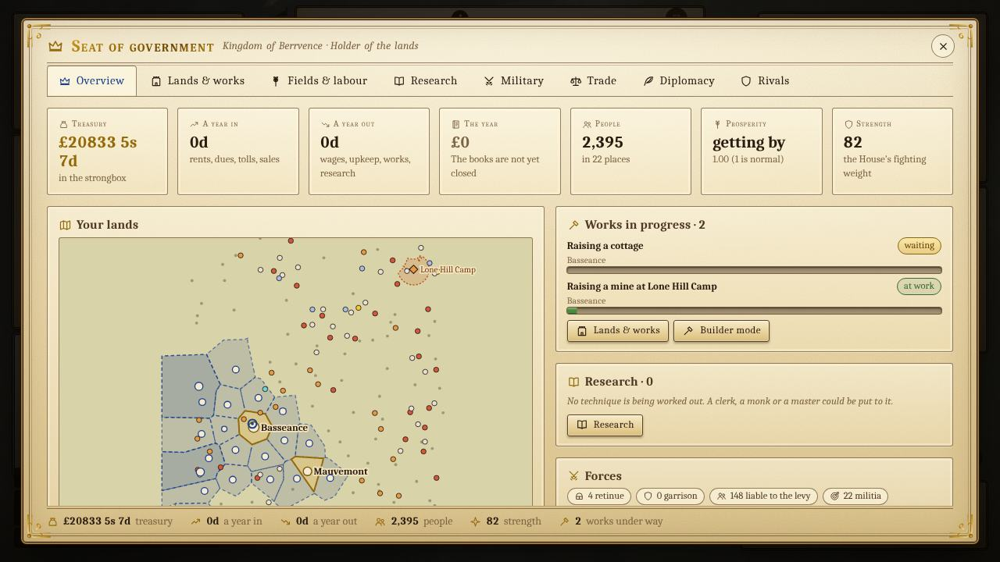
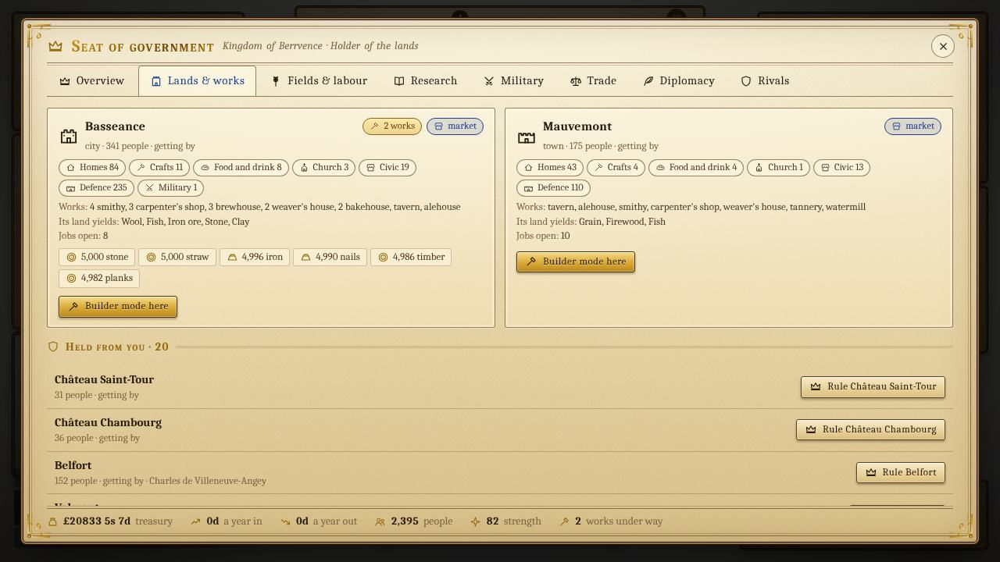
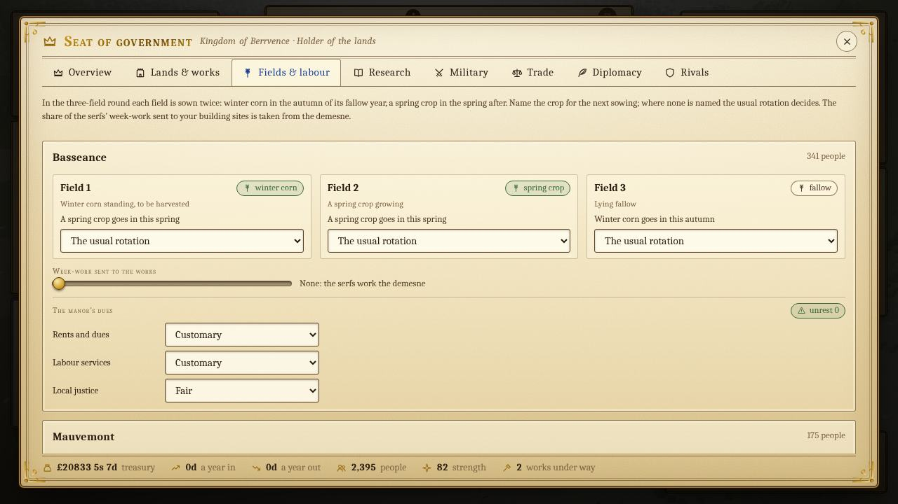
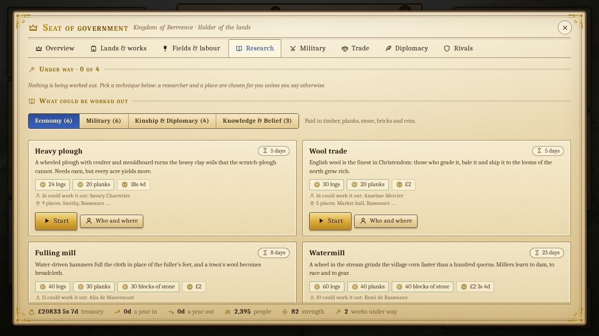
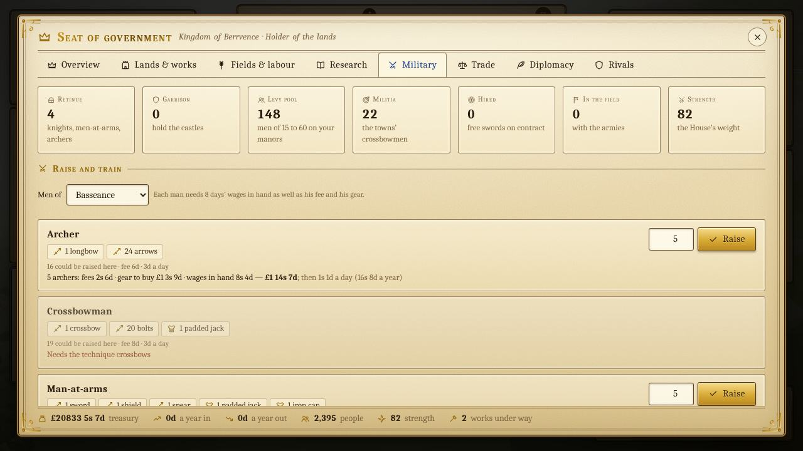
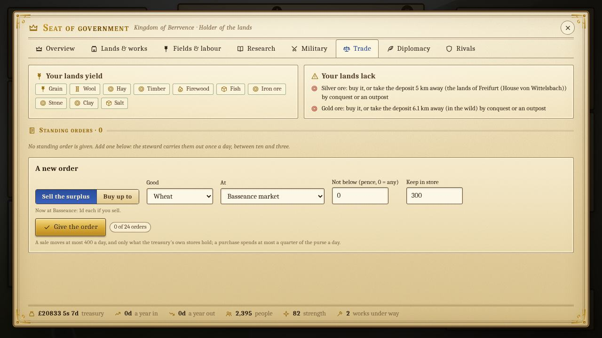
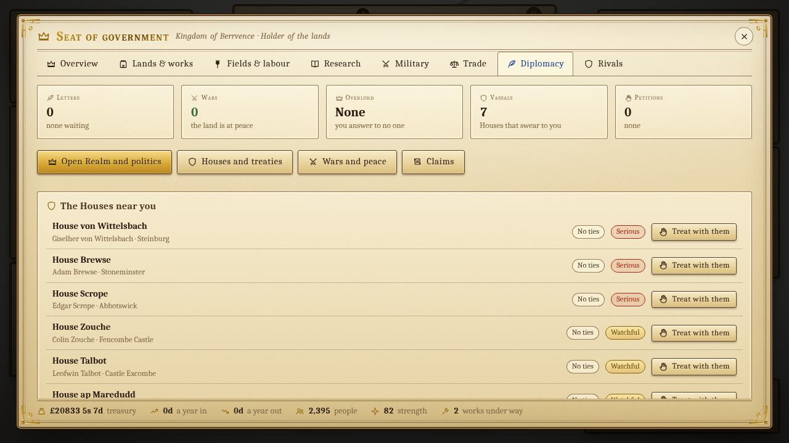
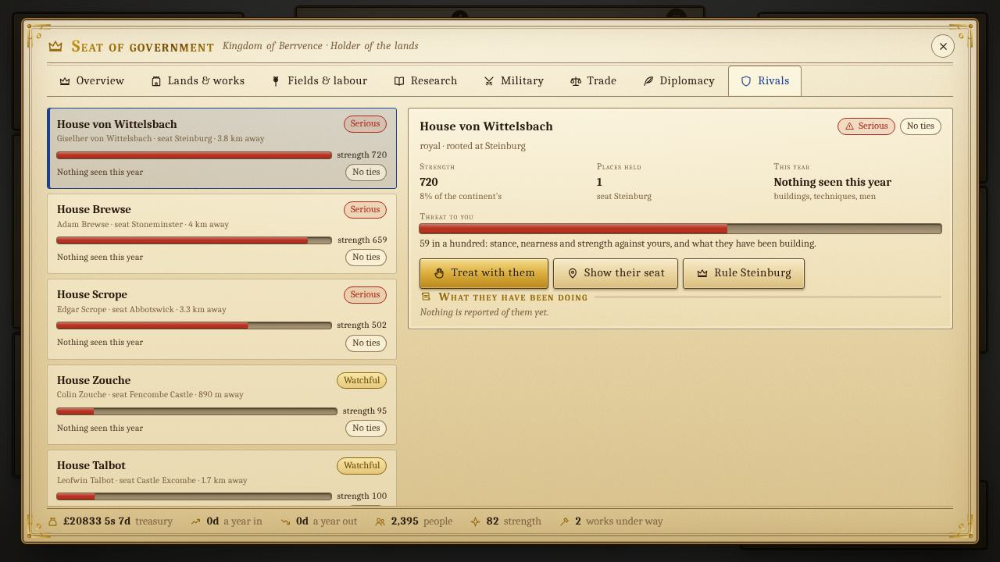
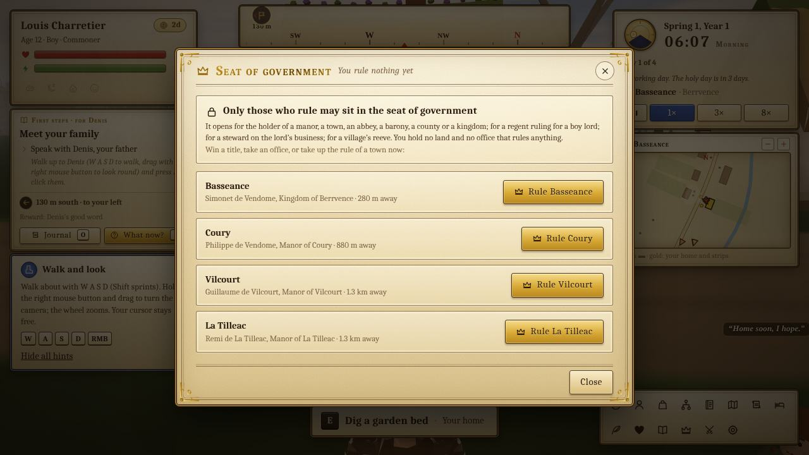

## 3. *Rule this town*

`ruleOffer(game, settlement)` (`src/ui/ruler/ruleTown.ts`) gives `{ label, tip, request }` when someone rules the place (the holder, the
regent for a boy lord, the steward when the holder cannot act: `realm.rulerOf`) and `sim.canSwitchTo` allows him; the request is
`{ panel: 'ext', name: 'liveAs', id: realm.rulerOf(s), data: { reason: 'rule' } }`, the flow of wave B6. Where you already rule the
place the offer opens the seat of government instead. It is on: the **settlement banner**, the **map's settlement card** and its
*People here* header, the **ruler's** *Held from you* list and the Rivals page, and the **builder's** "you cannot build" card.
(*Live as* on a row of *People here* opens the same panel with `data: { reason: 'choose' }`.)

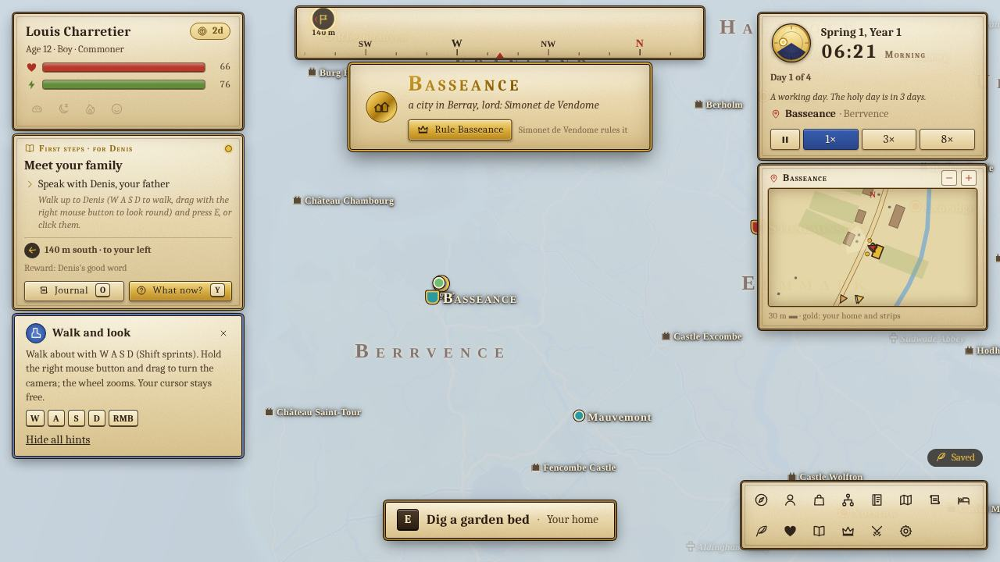

## 4. The map (`M`)

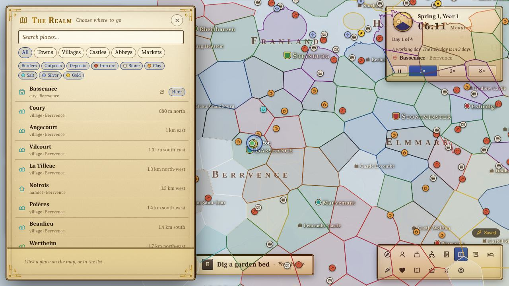

* **Borders**: `territory.landsPolygon(s)` for each settlement (one polygon for a castle and its village), filled and stroked in the
  colour of the House that holds the lands (`ownerOf(s).house` → its shield's field), drawn on a canvas under the panel and redrawn only
  when the camera, the territory's version, a layer or the selection changes (it is found out by projecting three reference points).
  The wild land an outpost claims is drawn dashed in orange (`outpostPolygons()`).
* **Deposits**: every `world.deposits` entry as a small coloured disc with a glyph (iron red, stone white, clay orange, salt cyan, silver
  pale blue, gold yellow, as in `docs/world/RESOURCES.md`), tooltip *"Iron ore deposit: rich / In the lands of Hjortlund (House
  Thorfinnsson) / A mine and a bloomery make iron…"*; clicking one shows its card, with **Found an outpost here** / **Build a working
  here** when you may (it opens builder mode over it with the right building in hand). Icons under the HUD's clock and dock are hidden.
* **Outposts**: `construction.outposts()`, a flag and the name.
* **Filters**: *Borders*, *Outposts*, *Deposits* and one chip per kind of deposit, kept while the game runs; the existing place filters
  (towns, villages, castles, abbeys, markets) and the search are unchanged.
* **A settlement's card** says whose lands they are (the House's colour and name), offers **Rule …** and **People here**.
* **People here**: everyone who lives there (`state.residentsOf`), the ruler first, then by rank; chips by calling (lords, reeve and
  stewards, church, smiths, knights, soldiers, merchants, crafts, farm folk, servants, children, householders and others) with how many;
  a search by name or calling; sixty rows at a time; **Live as** on each (`liveAs`, `reason: 'choose'`).

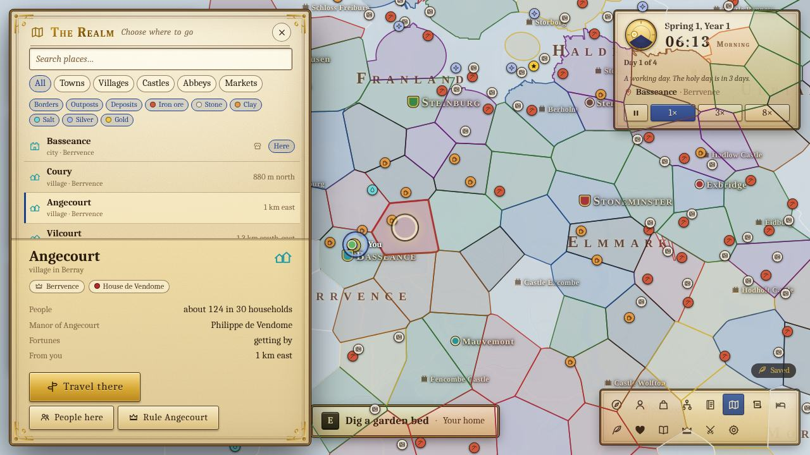
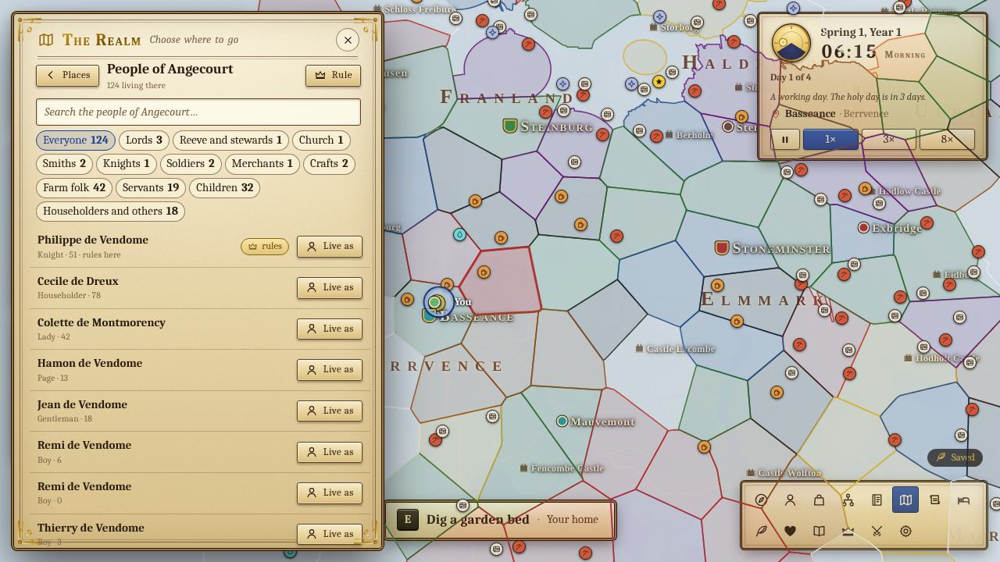
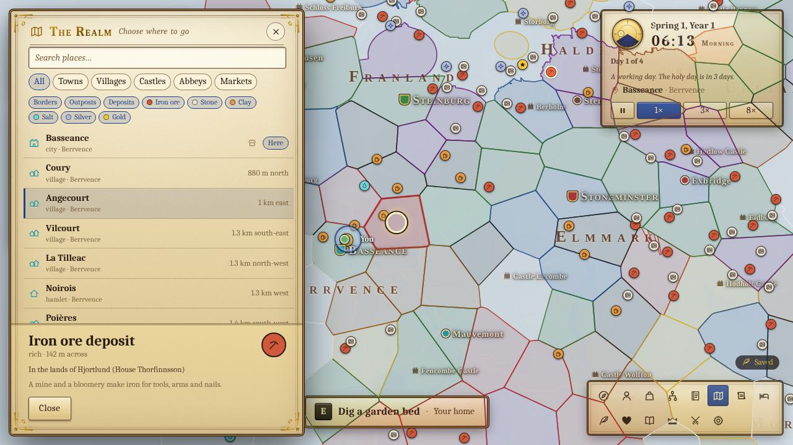

## 5. News

A `news` event with `threat ≥ 0.5` makes a toast below the interface's own (its own HUD part: `registerHudPart('ruler.news')`), with the
House's name, the threat in words and the deed, and, if you rule something, a button to the Rivals page of the seat.

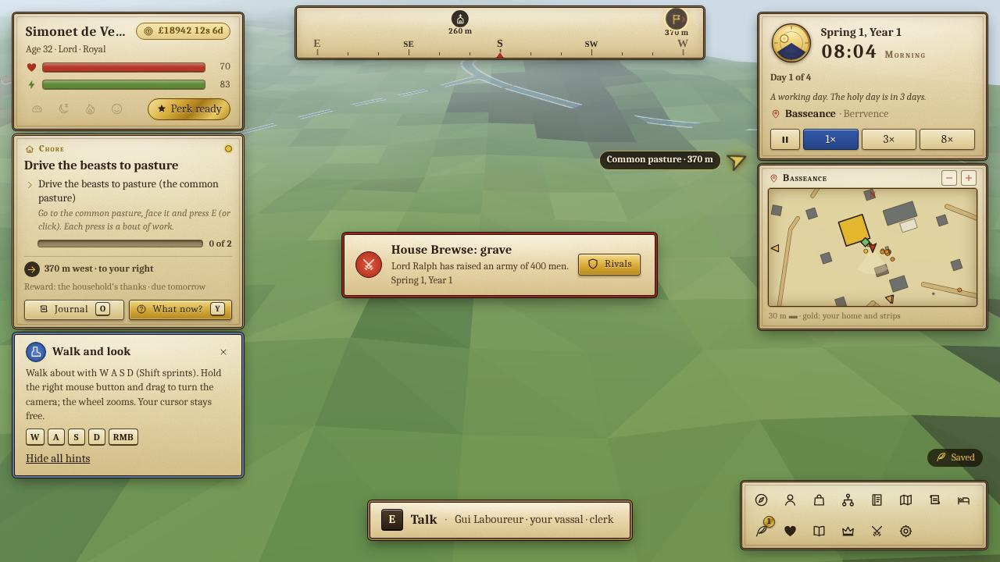

## Pure models and tests

Everything that can be a function is one, in `src/ui/builder/builderModel.ts` (catalogue grouping and filters, costs, requirements, the
ghost, the cursor's label, outposts' names, site cards, materials with the carts on the road, the queue, conditions, what can be done
to a building), `cameraModel.ts` (the bird's-eye camera, dragging, the movement keys), `src/ui/ruler/rulerModel.ts` (pages, the year in
words, the books, stores, research by branch and what the buttons offer, the cost of raising men, crops, what a land yields and lacks,
orders, rivals, news, the overview map's geometry) and `src/ui/core/mapModel.ts` (layers, deposit tooltips, House colours, who lives
where and by what calling). Tests: `tests/ui/builder/` (the models, the camera driver against a renderer with an overview camera and one
without, and the models against the real construction module), `tests/ui/ruler/` (the models against fakes and the real realm;
*Rule this town* against a fake registration of the live-as panel and the real realm), `tests/ui/mapLands.test.ts`.
`node tools/lands-flow.mjs` drives the real game: a child's cards, the map's layers, filters, deposit and people lists, the banner,
builder mode (camera, pan, zoom, turn, catalogue, search, ghost, `Q`/`E`/Shift+wheel, the red reason, place for me, the site and the
building cards, hired hands, priority, cancel, an outpost named by a baron, leaving), every page of the seat with an order on each of
the main ones (a crop plan, research started and stopped, archers raised, a trade order given and withdrawn) and the news toast.

## Contract use and changes

No contract was changed. Used: `UiRendererControls` (`setGhost`, `setBuildArea`, `setOverview`, `orbit`, `zoom`, `pan`, `pick`,
`project`, `screenToGround`, `setCameraPose`, `setCameraMode`, `cameraMode`, `cameraYaw`); `registerPanel('builder' | 'ruler')`,
`registerHudPart('lands.banner' | 'ruler.news')`; the `liveAs` ext panel as an opaque request. Added to my own files only:
`BuilderOpen` (`{ settlement?, at?, kind? }`) and `RulerOpen` (`{ page?, house? }`) as the `data` of the two ext panels, so the ruler's
lists, the map's deposit card and the news toast can open them somewhere (`{ panel: 'ext', name: 'builder', data: { at } }`).

## Hand-offs and gaps

* **Renderer (B2):** nothing here draws the ghost, the tint or the overview camera: they are `setGhost`, `setBuildArea` and
  `setOverview`. Until they exist builder mode shows the land from its own camera, without the ghost and the tint (the cursor's label
  and the red reason are the interface's and work). The renderer should make `UiRendererControls.setOverview` truly absent when it has
  none (`session.ts` `makeControls` forwards it unconditionally today); the builder would then not need to look.
* **Integrator:** (1) `makeControls` as above; (2) both builder mode and the seat are ordinary ext panels of their own *groups*
  (`'builder'`, `'ruler'`) so a panel opened from them (politics, the army panel, the person page) stacks above and `Esc` comes back;
  (3) the dock buttons for Builder (`B`) and Ruler (`U`) are B6's; (4) the map draws the `construction.outposts()` as DOM flags; if the
  integrator also feeds `MapMarker 'outpost'` to the renderer they will be drawn twice.
* **Not done:** the builder does not let you drag out a run of wall or palisade segments (one click, one segment); the Overview map
  does not show roads; *Dub a knight* is offered for the men raised through `recruit` only (those `troops()` lists).
