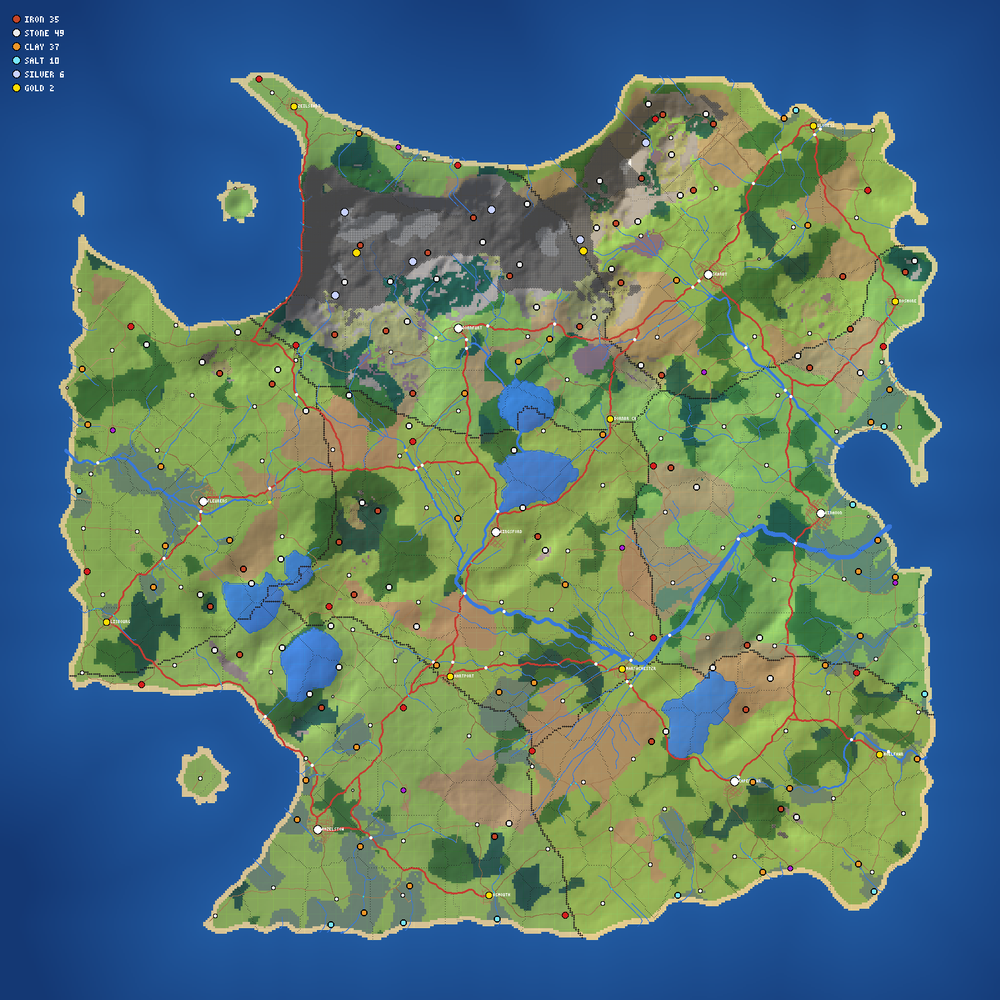
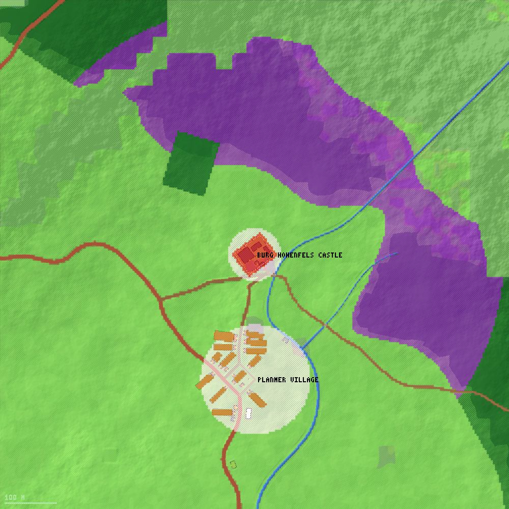

# Resources, lands and territory (civilization pass, `docs/CIV.md` §4 and §7)

Where the ground holds iron, stone, clay, salt, silver and gold; whose lands every point of the continent is; and who may be
where on them. Three layers, one rule shared by all of them:

| layer | code | what it is |
|---|---|---|
| **Deposits** | `src/world/deposits.ts` (stage 8 of `generateWorld`) | the list `WorldModel.deposits` (a pure function of the seed) |
| **Lands** | `src/world/lands.ts` | whose lands a point is in: settlement Voronoi cells clipped to a radius by kind |
| **Territory** | `src/sim/territory/**` (`installTerritory`, `sim.services.territory`) | land classes, owners, trespass, resource profiles, deposit queries, outposts' claims |

The generator and the sim use the same `LandsIndex`, so a deposit's `settlement` (whose lands hold it at world generation) and
what the territory module says about the same point never disagree about where a settlement's lands end.



*`deposits-abc.png`: the 139 deposits of seed `abc` (iron red, stone white, clay orange, salt cyan, silver pale blue, gold yellow).
Grey ground is wild (beyond every settlement's lands, or high mountains); thin black lines are the borders between settlements' lands.
Make it with `npx tsx tests/world/depositMap.tool.ts --seed abc --out docs/world --lands`.*

---------------------------------------------------------------------------------------------------

## 1. Deposits

```ts
interface Deposit { id: number; kind: 'iron'|'stone'|'clay'|'salt'|'silver'|'gold'; x: number; z: number;
                    radius: number;      // m: a mine, quarry, clay pit or salt pan must stand within it
                    richness: number;    // 0..1 yield per worker-day relative to the best
                    settlement: number } // whose lands hold it at generation (-1 = wild)
```

`id` is the index in `world.deposits`. The list is deterministic from the seed and independent of the rest of the generator: it runs
after the layouts, reads the terrain, strips, plots and roads they made and changes none of them (the only thing it adds to the
world are the levelled working floors below). Cost: **about 30 ms of CPU, cold** (`tests/world/deposits.perf.test.ts`; budget 60 ms;
`world.timings['phase.deposits']`, finer laps `d.*`).

### Where each kind lies

A pass over the macro grid scores every dry cell for every kind from its biome, height, slope and nearness to water or coast, and
from a slowly varying random "province" so ores come in belts and not evenly. Candidates are taken best first, with a minimum
spacing, a cap per kingdom and a minimum per kingdom, then moved to the flattest dry, empty spot within ~35 m of the cell.

| kind | ground it likes | per kingdom | spacing | extent (radius) | richness |
|---|---|---|---|---|---|
| **iron** | uplands, mountain flanks, moors, heath and wooded hills; moderate slopes (steepest 0.34); belts | 3 – 8 | 760 m | ~55 m | 0.3 – 0.95, richest high up |
| **stone** | rocky uplands and mountains, bare slopes, **river cliffs** (steep banks of a stream), low rises | 3 – 9 | 640 m | ~70 m | 0.4 – 1 |
| **clay** | river and lake banks, marsh, flood plain; flat (≤ 0.09), low (< 190 m), 3 – 80 m from water | 3 – 6 | 560 m | ~58 m | 0.2 – 0.62 (thin banks) |
| **salt** | coastal marsh and the flats behind the beach; low (< 12 m), flat, within ~260 m of the sea | 0 – 3 (coasts only) | 1100 m | ~72 m | 0.25 – 0.68 |
| **silver** | mountains and high uplands (≥ 260 m; a world with no real mountains makes do with its highest hills): scarce, a few to a kingdom | 0 – 5, 3 – 7 in all | 1250 m | ~38 m | 0.4 – 0.92 |
| **gold** | the banks of narrow (≤ 7 m) mountain **streams**, the highest first (9 – 17 m from the stream's line): alluvial | 0 – 2, 2 – 3 in all | 3200 m | ~30 m | 0.3 – 0.8 |

Rules that hold for every deposit (and are tested, `tests/world/deposits.test.ts`, on two full and two sparse continents):
dry land inside the map, not on a road (≥ 3 m), a plot, a strip, a parcel or in a settlement; the extents of two deposits never
touch; the same kind is at least 200 m apart (usually 500+); every kingdom with land has **iron and stone** (at least 3 where the
ground allows it, thin seams in its best hills where it does not) and **clay**; silver and gold are rare (3 – 7 and 2 – 3 on a
continent) and only in the high ground, so some realms hold them and the others must trade, conquer, or found an outpost where
they lie.

Measured on seed `abc` (7 kingdoms, 139 deposits for 140 settlements) and the default sim seed `millennia`:

| kind | abc: total (per kingdom) | millennia: total (per kingdom) | in the wild |
|---|---|---|---|
| iron | 35 (4 8 3 8 3 4 5) | 43 (8 3 8 3 8 8 5) | 3 / 1 |
| stone | 49 (8 9 6 9 4 8 5) | 49 (9 3 9 3 9 9 7) | 4 / 2 |
| clay | 37 (6 4 6 3 6 6 6) | 34 (3 6 6 6 3 4 6) | 0 / 0 |
| salt | 10 (0 0 3 1 2 1 3) | 7 (0 3 0 3 0 0 1) | 0 / 0 |
| silver | 6 (0 4 0 2 0 0 0) | 3 (0 0 0 0 1 2 0) | 5 / 2 |
| gold | 2 (0 1 0 1 0 0 0) | 2 (1 0 0 0 1 0 0) | 2 / 1 |

Close-ups: `deposit-iron-abc.png` (an iron deposit in the uplands: the dotted circle is its extent, the small square its levelled floor),
`deposit-clay-abc.png` (clay in marsh by a stream's mouth), `deposit-gold-abc.png` (alluvial gold on a mountain stream),
`deposit-salt-abc.png` (salt pans behind a beach). `npx tsx tests/world/depositMap.tool.ts --seed abc --out docs/world --zoom iron,stone,clay,salt,silver,gold`.

### Working floors

Iron, stone, silver and gold deposits are in hills where the detail noise bumps the ground by a metre in a few metres, so a
mine (6 m square) or a quarry (16 m) would not fit. Where the ground under a deposit's centre is not already level, **a level working
floor is cut into the hillside** (an extra "platform" of the world's own height model: 18 m square for iron and silver, 22 m for
stone, 12 m for gold, blended 6 m into the slope; no yard, no road, vegetation cleared). `world.heightAt` is flat there, so
construction's slope check passes at the deposit's centre. Clay and salt lie on flat ground and need none.

### Workings stand on deposits

`DEPOSIT_FOR_BUILDING` (`mine` → iron / silver / gold, `quarry` → stone, `clay_pit` → clay, `salt_pan` → salt) and
`alignDepositsWithPlots(deposits, plots, lands)`: after the deposits are made, any plot of one of those kinds that does not stand on a
matching deposit gets one under it. **The generator places no mine, quarry, clay pit or salt pan today** (nothing to align; a test
fails if one ever stands on bare ground), so the pass adds nothing yet.

### Mock worlds

`createMockWorld` (`src/sim/testing/mockWorld.ts`) has a few deposits from a stream of its own (the rest of the mock world is
unchanged): per kingdom two each of iron, stone and clay near its villages (inside their lands), one salt in every other kingdom, and
silver and gold far from any settlement in the first kingdom (wild where the world leaves room).

---------------------------------------------------------------------------------------------------

## 2. Lands (`src/world/lands.ts`)

*Whose lands is a point in?* `LandsIndex.lookup(x, z)` → a settlement id, or -1 (wild).

* Each settlement's lands are its **Voronoi cell clipped to a radius by kind** (`LAND_RADIUS`): hamlet 1200 m, village 2000 m,
  town 2500 m, city 3000 m, abbey 1200 m, priory and nunnery 1000 m, a castle without a parent village (a fort) 1000 m.
  Of the settlements whose radius reaches the point, the **nearest** holds it (so a hamlet's small circle never leaves a gap a village's
  wider reach could have filled).
* A **castle** that has a parent village **shares the parent's lands** (its cell belongs to the parent and is clipped at the parent's
  radius round the castle); the castle's own precinct and park are the castle's (below).
* An **abbey, priory or nunnery keeps an estate of its own** (a deliberate departure from "shares its parent's": its fields and
  parcels belong to it, and its parent town is typically 1.5 – 2 km away, at the edge of the town's own lands).
* **The high mountains are wild** (`HIGH_COUNTRY_REACH` = 0.4): beyond 40 % of a settlement's reach, Mountain and Snow ground is not
  anyone's, however near the radius allows. With the radii alone the continent is wall to wall lands (settlements are ~800 m apart) and there is
  nothing left to found an outpost on; with the rule 4 – 5 % of the land is wild (the northern range, a few remote shores), together with the open sea
  beyond 1 – 3 km of the coast.
* `builtUp(x, z)`: the nearest settlement whose built-up area holds the point (`radius` × 1.05; for a walled town no further than
  45 m beyond its walls, whatever the farms round it make `radius` out to be).

---------------------------------------------------------------------------------------------------

## 3. Territory (`src/sim/territory`)

`installTerritory(sim, deps)` builds the land's geometry from the world (strips, parcels, building footprints, roads, castle
precincts, manor courts; a few tens of ms once), registers `sim.services.territory` and listens to the events that move titles and wars. It runs
no system per step, per hour or per day, writes nothing to the state until a lord grants leave, and finds the other modules
(`politics`, `military`, `construction`) lazily and guarded: any of them may be missing. Queries are pure functions of the world,
the state and the day.



*`land-castle-abc.png`: yellow strips (fields), light green pasture, dark green forest, violet the castle's deer park, red the castle,
white a settlement's built-up ground (town), magenta a manor's court, grey wild ground. `npx tsx tests/sim/territory/landMap.tool.ts --seed abc --out docs/world --at castle --n 3 --size 1400`.*

### `landAt(x, z): LandInfo`

`{ kind, settlement, house, title, household, strip, parcel, building }`; budget 20 µs, **measured 2.5 µs**.

| `kind` | what | `settlement` | household |
|---|---|---|---|
| `field` | an open-field strip | the strip's | the strip's holder (0 = the lord's demesne strip) |
| `pasture` / `meadow` | common pasture and meadow parcels; also any open ground inside someone's lands that is neither wooded nor otherwise classed (the manor's waste) | the parcel's / the lands' | 0 |
| `garden` | a croft garden | the parcel's | the household living in the house it lies behind |
| `demesne` | the lord's closes: `demesne` and `orchard` parcels, and the **manor court** (the manor house with its barn, stable, dovecote and the farmyard between them, plus 6 m) | the manor's | 0 |
| `forest` | woodlot parcels, and open ground inside someone's lands where the woodland map is ≥ 0.3 | the lands' | 0 |
| `park` | woodland within 450 m of a castle, inside its lands: the baron's deer park | the **castle** | 0 |
| `town` | inside a settlement's built-up radius (streets, green, yards) | that settlement | 0 |
| `castle` | inside a castle's walls (+ 6 m of bailey); a city's castle is the compound round its keep | the castle (or city) | 0 |
| `road` | within a road's half-width + 1 m (outside built-up areas) | the lands' (-1 in the wild) | 0 |
| `water` | sea, lake, river | the lands' (-1 in the wild) | 0 |
| `wild` | beyond any settlement's lands (and no outpost's claim) | -1 | 0 |

Order: strip, parcels, castle precinct, manor court, built-up radius, road, water, outposts' claims, forest/park, pasture, wild.
`strip`, `parcel` and `building` carry the entity under the point (-1 none); `building` is any building standing there, **including ones
raised in play** (the module keeps their footprints and refreshes on the `construction` events) and not one pulled down.
`settlementOf(x, z)` is the same answer without the rest; `landsRadius(s)` is the lands' radius (a castle's is its parent's).

`house` / `title` are the **title the land is held under** and its holder's House: the settlement's manor, else barony, town, abbey,
else (for the earl's own castle) the county it seats, else its county, else its kingdom. A vacant title (holder dead) is kept by its
liege until it is filled. **A person's lord** is the House holding their home settlement's title (a castle's people are the castle's
lord's). `ownerOf(settlement)` (additive) gives `{ house, title, holder, lord }`, `lord` being the regent while the holder is a child
(under 16) or a captive.

### `trespass(person, x, z): TrespassCheck`

`{ level: 'none' | 'private' | 'hostile', land, reason, cause?, lord? }`; budget 40 µs, **measured 3 µs**. A dead person, a prisoner (he
goes where he is led), wild land and land no House holds are never trespass.

**Hostile** (any land of the owning House: fields, roads, water, town), in this order:

1. the person is an **outlaw** (`flags.outlaw`) — on any House's land but his own (`cause: 'outlaw'`);
2. the owner's **lord counts him an enemy**: the lord's stored opinion of him ≤ -50 (`enemy`);
3. the owning House is **at war** (`politics.stance` = `war`, or `military.hostile` and a war between them or their lieges), **in a feud**
   (`military.hostile` without a war), or on **hostile** terms (`politics.stance` = `hostile`, grievance ≥ 35) with the person's House
   **or with his lord's House** (a commoner follows his lord's quarrels): `war` / `feud` / `hostile`. The reason says which:
   "lands of House Avenel, at war with yours" / "…with your lord's".

**Private** (only when not hostile), for a stranger on `demesne`, `park` or `castle` land (`castle` only **at night, or on alert**:
under siege, or a hostile army within 1.5 km), unless he has business there:

* belongs: of the lord's House (so sworn people too), or of his household, or a member of a household the House keeps (garrison,
  monastic, service);
* an **office** at that place (reeve, bailiff, steward, a household knight at the castle…);
* on the manor's own **demesne**: the manor's bound people (`estate: 'unfree'`, living there) work his closes;
* the lord's **leave** (`grantLeave`, below);
* the **market day** of a town with a market (`isMarketDay`): everyone has business on its private ground, by day (not by night, and not
  in a castle that is shut).

Reasons in plain words: "the lord's closes at Dromore", "the lord's deer park at Cyney", "the grounds of Dun Balross, closed at night" /
"…closed while the castle is on alert". Poaching is a matter for the hunting actions (they can ask `landAt(...).kind`): walking through
forest is not trespass, walking through the park is.

Additive helpers for the patrol (wave B): `grantLeave(person, settlement, days)` and `leaveUntil(person, settlement)` — a pass, a fine
paid, business accepted: the person is no trespasser on that settlement's private land until the day runs out (never on hostile land);
saved in `state.ext['territory']` (`{ v: 1, leave: [[person, settlement, untilDay]] }`, written only when a leave is granted, expired
ones dropped at dawn). `exitFrom(person, x, z)`: the nearest point (looked for in eight directions out to 1.5 km, refined to ~2 m)
where the person is not a trespasser — where the patrol escorts him to; null if none (deep in an enemy's lands).

### Resources

`resources(settlement): ResourceProfile` = `{ deposits, forest, fertility, coast, river, yields }` for the settlement's lands (a
castle's are its parent's). `deposits`: those whose `settlement` is its lands, plus those within 600 m of its outposts. `forest`:
the share of its land (sampled every ~160 m on the macro map) where the woodland map is ≥ 0.3. `fertility`: mean soil of its strips
(area-weighted; of the land if it has none). `coast`: a port, or sea or beach inside its lands. `river`: a river runs through them.
`yields` (good ids): `grain` (strips and fertility ≥ 0.25), `wool` (pasture parcels, or a fifth of the land upland, moor or heath), `hay`
(meadow parcels), `timber` (forest ≥ 0.18), `firewood` (≥ 0.06), `fish` (coast or river), and from deposits `iron_ore`, `stone`, `clay`,
`salt`, `silver_ore`, `gold_ore`. Cached (all 140 profiles: ~30 ms, 0.2 ms each, computed on first use); rebuilt when an outpost is founded.

`deposits()`, `depositsNear(x, z, radius, kind?)` (centre within `radius`, nearest first), `depositAt(x, z, kind?)` (the deposit whose extent
holds the point; where two overlap the one the point is nearest the middle of): spatial index, ~0.5 µs.

### Outposts

`sim.services.construction?.outposts()` (`OutpostView`): **wild land within 600 m of an outpost** reports the outpost's parent
settlement as its `settlement`, the House holding that settlement as `house` and its title as `title`, with the terrain's own kind
(`wild`, or `forest` / `road` / `water` / `town` where those apply). Settlements' lands win over a claim. The deposits the claim holds join the
parent's profile. Founding one bumps `version()`; the claims are re-read on every `construction` event and once an hour.

### `version()`

Bumps when ownership changes: on `inheritance`, `office` (of a title: lord, baron, earl, king, abbot, bishop), a holder's `death`,
`war`, `stance`, `siege`, `raid` and `battle` events at once; and, from a once-an-hour look (taken lazily by the next query), when
the sum over every title's holder, the wars, the feuds among Houses with armies in the field or the outposts differ from what the
caches were built from (a quiet change, a feud running out). A UI refreshes its picture when it changes; it moves a few hundred times
a game year. `refresh()` forces the look (tests, tools).

### Budgets and tests

| | budget | measured |
|---|---|---|
| `landAt` | ≤ 20 µs | 2.5 µs |
| `trespass` | ≤ 40 µs | 3 µs |
| `depositAt` | — | 0.5 µs |
| deposit generation (cold CPU) | + ≤ 60 ms | ~30 ms |
| install | — | 25 – 100 ms once |

(`tests/sim/territory/territory.perf.test.ts`, `tests/world/deposits.perf.test.ts`: `PERF=1 npx vitest run --no-file-parallelism <file>`.)
`tests/world/deposits.test.ts` (determinism, terrain fit per kind, counts per kingdom, scarcity, clear ground, levelled floors, mines on
iron), `tests/world/lands.test.ts`, `tests/sim/territory/{land,owners,trespass,outposts,deposits,resources,save}.test.ts` (land
kinds at sample points on a stand-in world and the real one, owners after a title changes hands / is vacant / is a child's, trespass
levels: war, feud, hostile terms, outlaw, enemy, private land, belonging, offices, leave, market day, castle by night and under
alarm, outposts' claims, resource profiles, the saved leave, and that installing the module leaves a run's state hash unchanged).

### Tuning (`src/sim/territory/config.ts`, `src/world/lands.ts`, `src/world/deposits.ts`)

`LAND_RADIUS`, `HIGH_COUNTRY_REACH`, `TERRITORY.{outpostClaim 600, parkRadius 450, forestMin 0.3, roadMargin 1, alarmRadius 1500,
enemyOpinion -50}`; per kind in `SPECS` (min, max, spacing, threshold, radius, richness, maxSlope), `PAD_HALF`.

### Hand-offs (wave B and the other builders)

* **Construction**: use `landAt(x, z)` for "inside allowed land" (`settlement`, `house`, `title`, `kind`) and for what the ground is
  (`road`, `water`, `field`, `building` ≥ 0); `ownerOf(settlement)` for who holds it; `depositAt(x, z, kind)` for mines, quarries, clay pits
  and salt pans (the centre of a mining deposit is a level floor 18 – 22 m across); an outpost founded in the wild: the next
  `landAt` near it says whose it is. Deposits in a castle's park or precinct belong to the castle (`landAt.settlement` = the castle)
  though `Deposit.settlement` names the lands' holder.
* **Economy**: `resources(settlement).yields` / `.deposits` say what a place can make; a settlement whose profile lacks a good has to buy it.
* **Patrols and captivity**: `trespass` for who and why (`level`, `cause`, `lord`, `reason`); `exitFrom` for the escort's goal;
  `grantLeave` when the stranger's business is accepted or the fine paid; `events.trespass` (contract) is yours to emit.
* **Drawing deposits and lands**: `world.deposits` has position, radius and richness; draw the extent with `radius`, the floor with the
  deposit's centre; `landAt` per cell is cheap enough to colour a tinted overlay (the builder's "your land" shading).
* **Known limits**: parks are an approximation (woodland within 450 m of a castle), and the generator places no initial mines or quarries
  (the AI and the player raise them); `trespass` has no notion of "employed" beyond household, House and offices; a feud between Houses
  without armies in the field is noticed only through its events.
